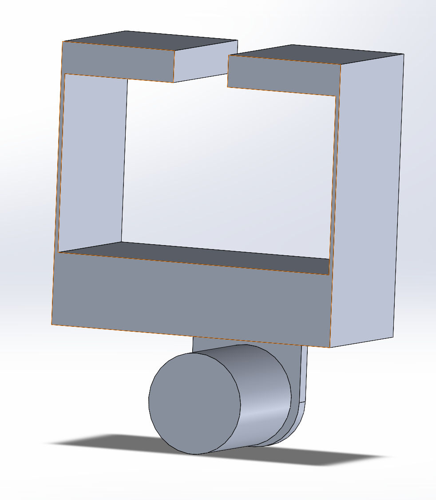
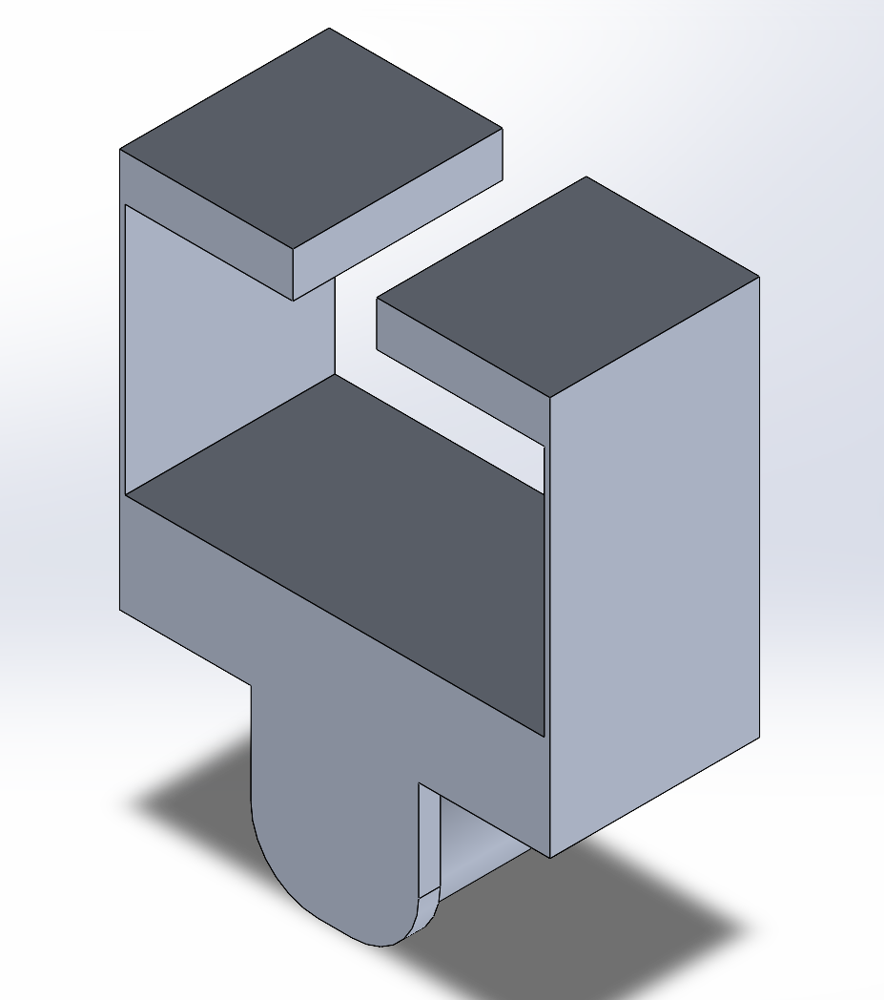
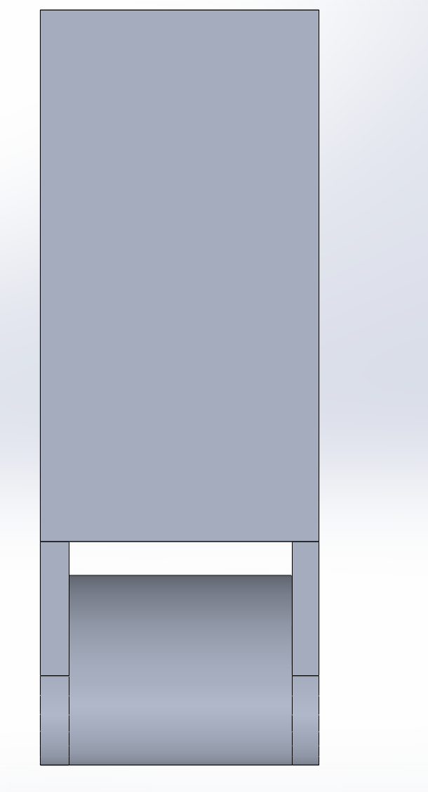
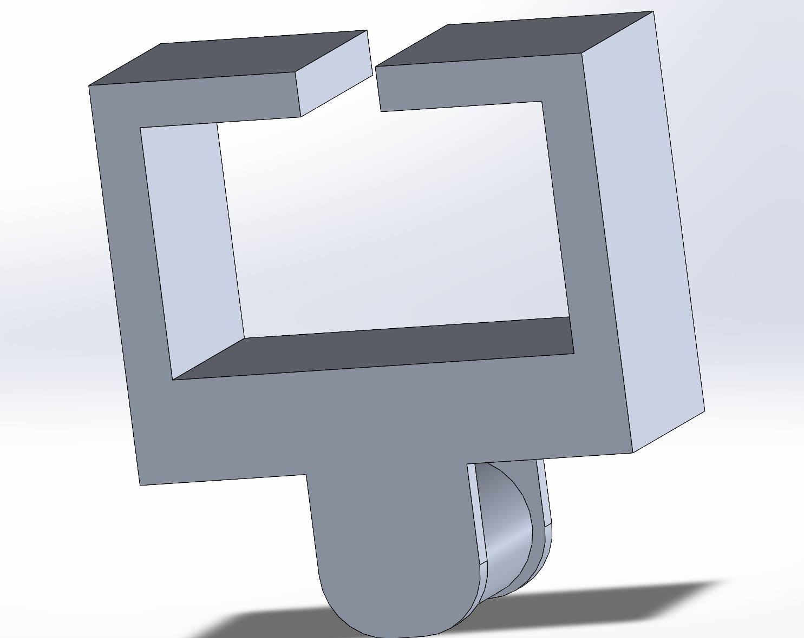
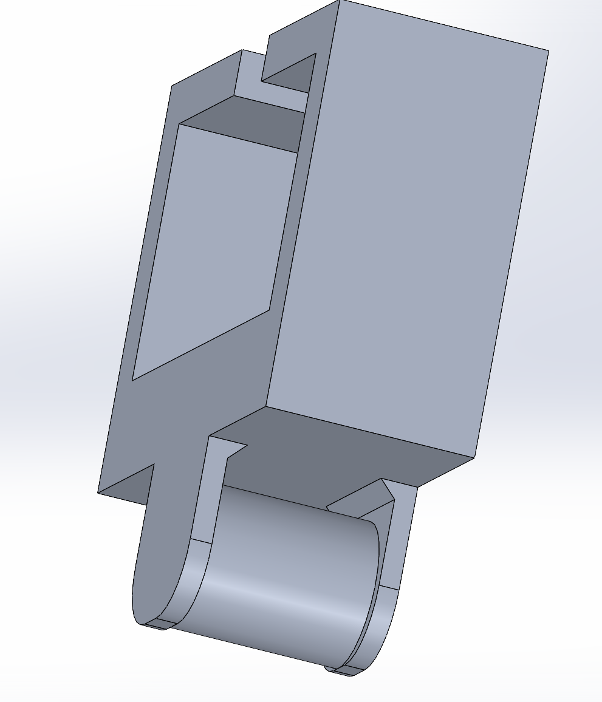
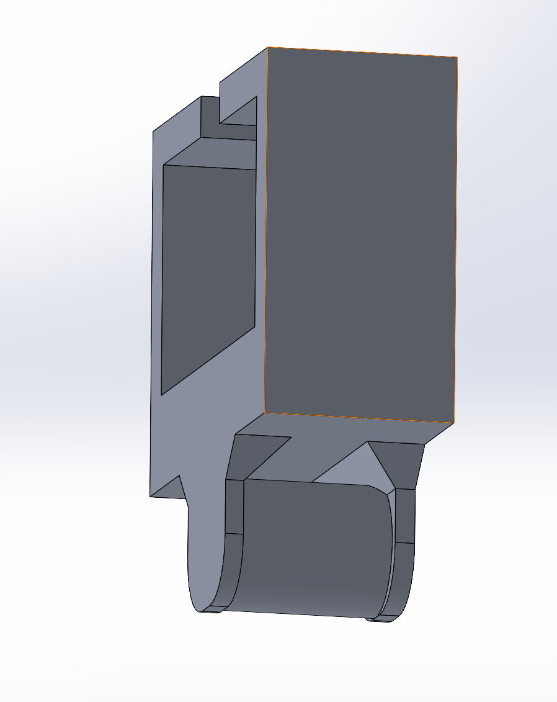

# A7 – [Topic]

## Objective

## Analyze

### Version 1

Base Design From previous assignment

### Version 2

Added a second connection to the strap interface

### Version 3

Thicken vertical walls that wrap around T mount (+0.25in)

### Version 4

Chamfers on Hinges

### Version 5

Increased size of chamfers

## Decide

## Communicate

