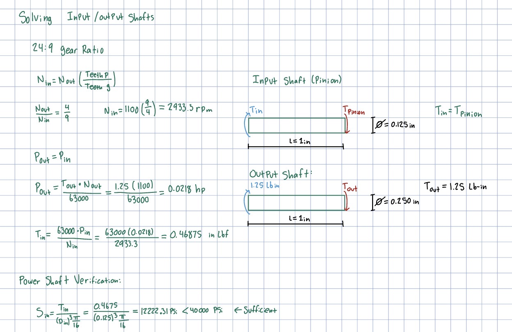
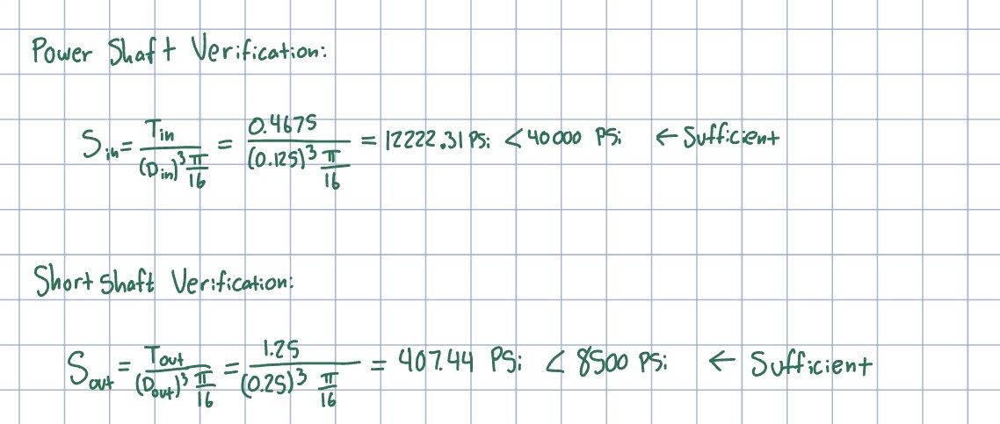
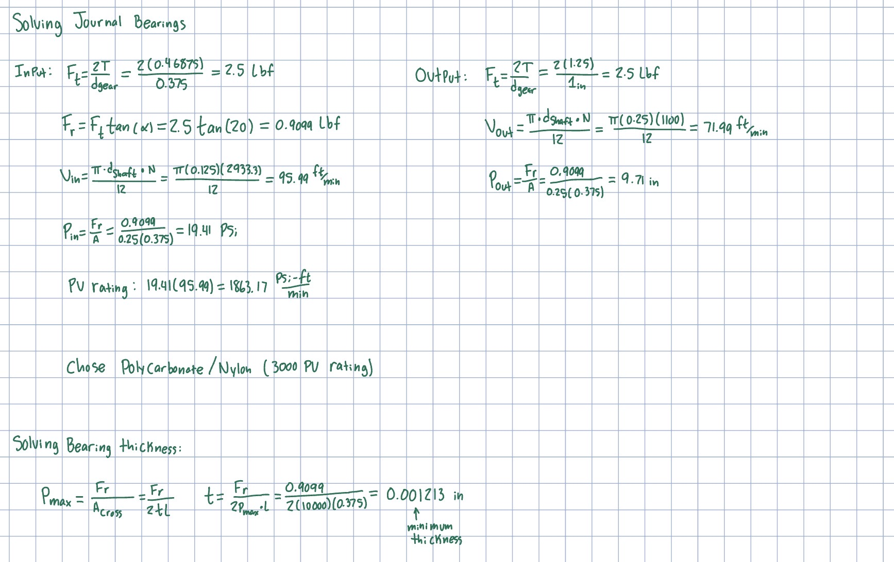
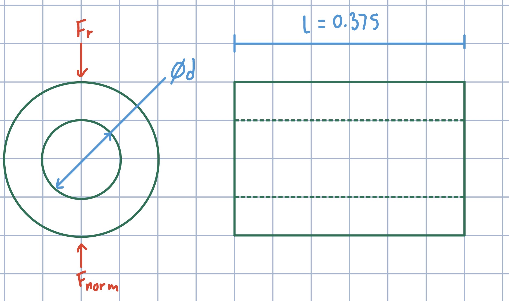

# A8 – Gears

## Objective

Knowns: 

Gear Ratio 24:9 

Output torque = 1.25 in-lbf

output speed = 1100 rpm

input shaft diameter = 0.125 in

input shaft length = 1 in

S(power shaft)= 4000 psi

S(short shaft)= 8500 psi

Unknowns:

Input Torque

Input Speed

Max torsional sheer stress

allowable sheer stress

There is a typo on the power shaft verification below, it should be 1222.31 psi < 4000 psi

Power Output Shell

Power Output Shell Dimensions

Power Output shaft journal Bearing

Power Output Gear

Power Output Shaft

Power Input Gear (Pinion)

Power Input Shell

Power Input Journal Bearing

Power Input Shaft

Screws for mounting both shell pieces together

Nuts that work with bolt above

Overall assembly

Interior View of overall assembly

Interior View of overall assembly (alt view)

## Analyze

## Decide

## Communicate

