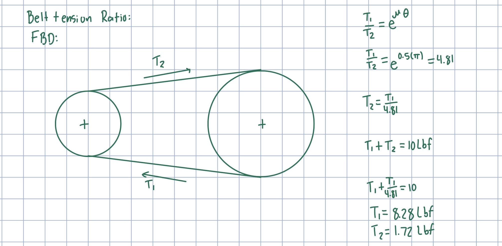
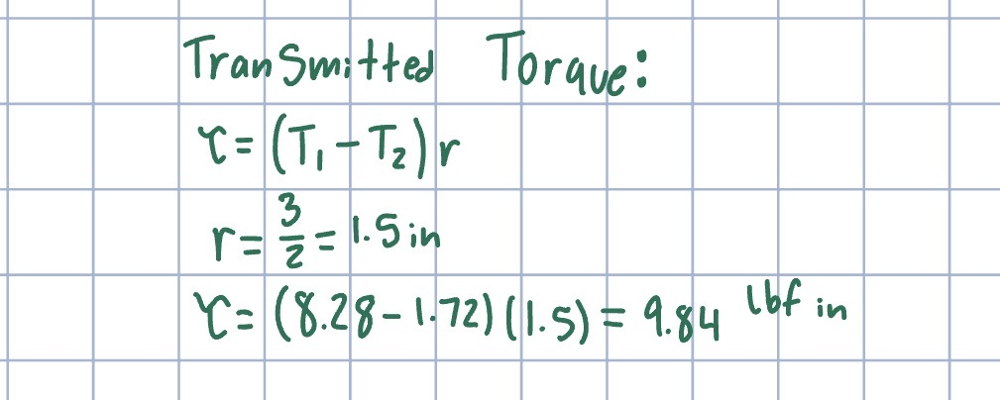
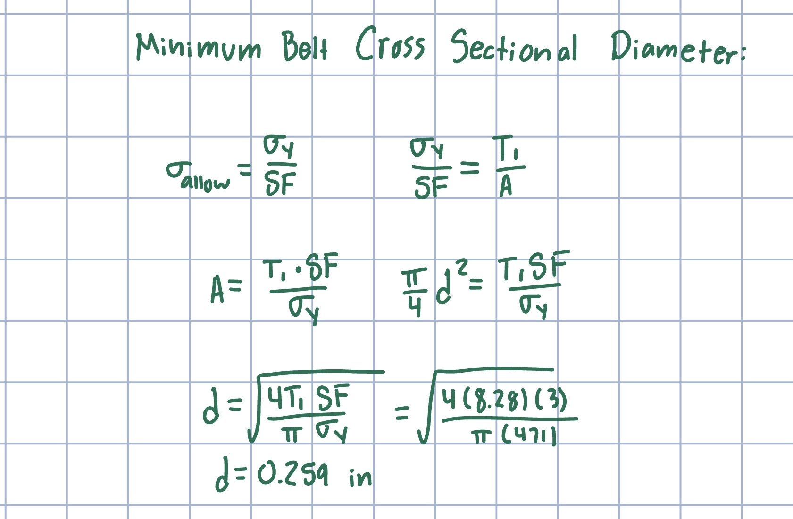
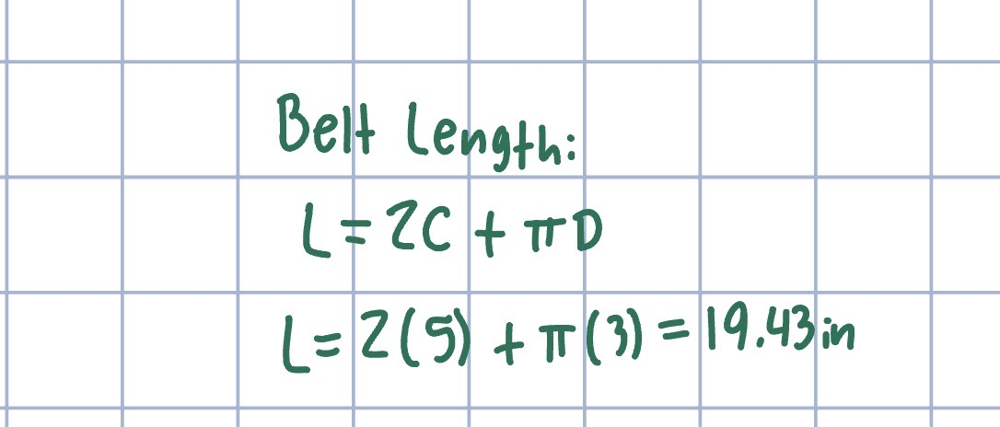
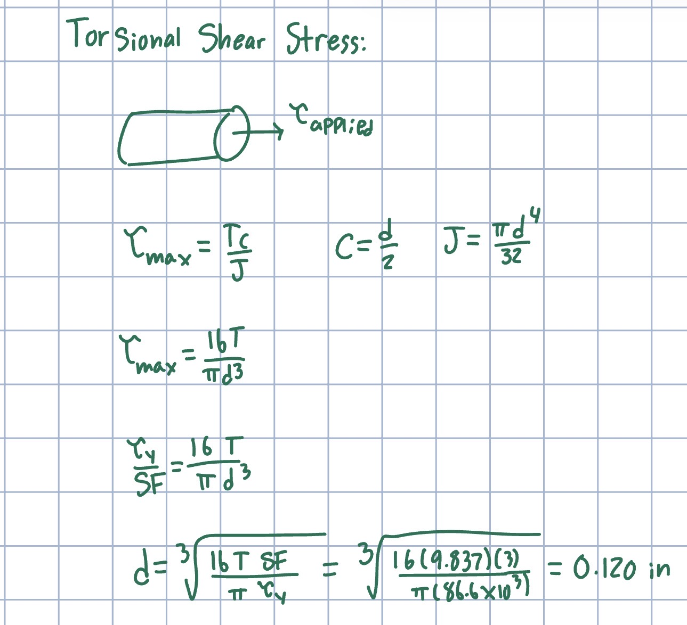
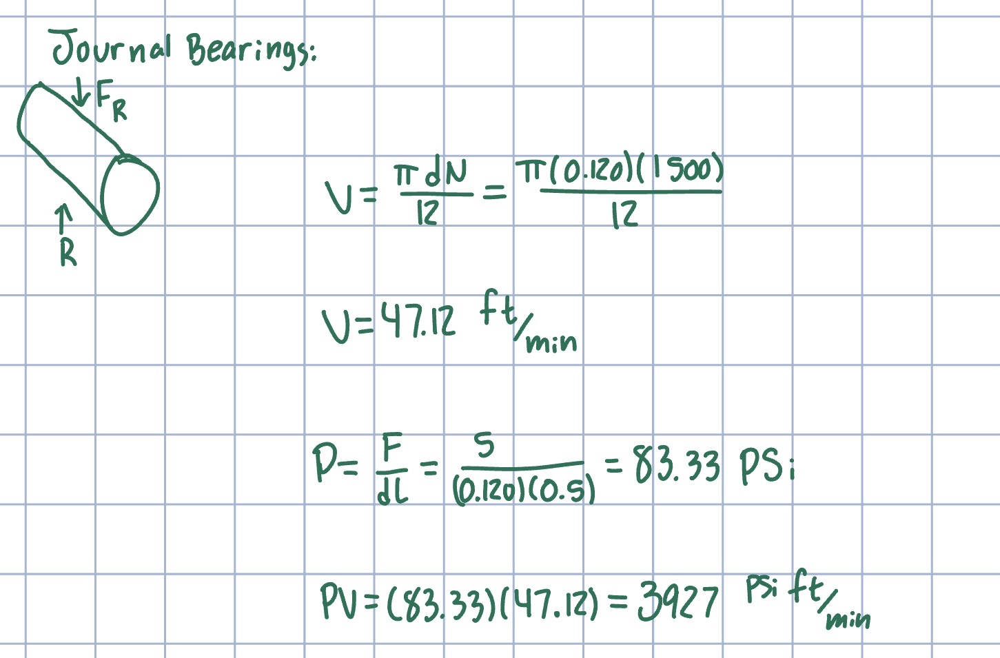
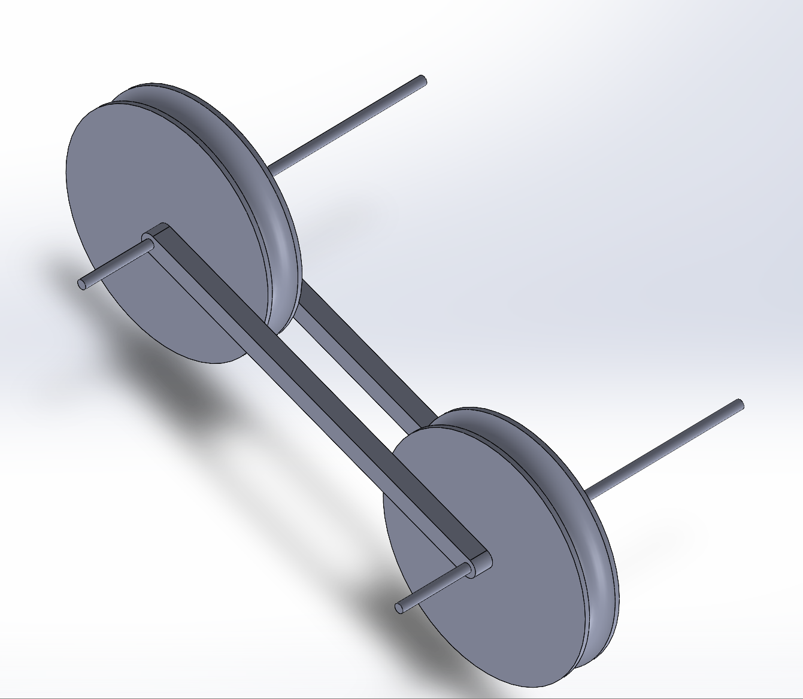

# A9 – Pulleys

## Objective

### Belt Tension Ratio Calculation

Known:

- Pulley diameter: D = 3in
- Center distance: C = 5in
- Rotational speed: N = 1500 rpm
- Initial static tension: 5 lbf per belt span
- Belt yield strength: Sy = 471 psi
- Factor of safety: 3
- Assumed coefficient of friction: m = 0.5
- Angle of contact: theta = 180 degrees = pi rad

### Transmitted Torque Calculation

### Minimum Belt Cross Sectional Diameter Calculation

### Belt Length Calculation

### Torsional Shear Stress Calculation

Known:

- Shaft material: 1060 hardened steel
- Applied torque: 9.84 lbf in
- Factor of safety: 3
- Shear yield strength used in my calculation: 86.6 ksi

### Journal Bearing Calculation

Known:

- Shaft diameter: d = .12 in
- Bearing length: L = .5 in
- Rotational speed: N = 1500 rpm
- Total radial belt force used: 10 lbf
- Number of bearings sharing the load: 2
- Assumed load per bearing: 5 lbf
- Selected bearing material: Maple

### Frame Design

The cross bars hold tension on the pulley system so the pully does not slip due to loss of friction. 

## Lessons Learned 

From this assignment I learned How different components in a belt system relate to each other in terms of strength. such as shaft diameter being used when calculating the max torque that can be ran through the pulley system as a whole. 

I spent around 4 hours on this assignment.

## Analyze

## Decide

## Communicate

