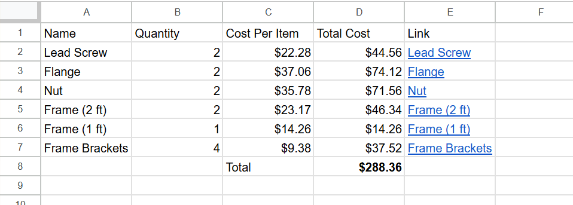

# A10 – Lead Screw Translating System

## Objective

For this assignment we were given the following parameters: 

Design and build a mechanically driven tensile tester capable of applying up to 2 kN axial tensile load with a controllable crosshead speed from 1 to 50 mm/min. Each team is responsible for the mechanical components outlined below. The system will provide consistent, well-aligned loading for polymers and light metals, suitable for instructional use and basic materials evaluation.

## Lead Screw Design

### Lead Screw Minimum Diameter Calculations: (Noah D)

### Torque and Speed Calculations: (Noah D)

### Nut and Flange Calculations: (Noah D)

## Crosshead Design 

### Designing Crosshead (Exie D)

### Beam Stress Analysis (Exie D)

### Beam Deflection Analysis (Exie D)

## Bill of Materials: (Noah D)

## Analyze

## Decide
_Reference your concept selection (Pugh matrix) here. How does this design follow from that decision?_

## Communicate

